<div align="center">

# Aeon · Practice-OS

**An open-source AI co-owner for solo therapists: find referral partners, draft the outreach, plan the meetings — nothing goes out without your OK.**

[](lib/meta.ts) [](LICENSE)
[](package.json)
[](lib/local-db.ts)
[](#built-for-the-meta-global-ai-developer-hackathon)

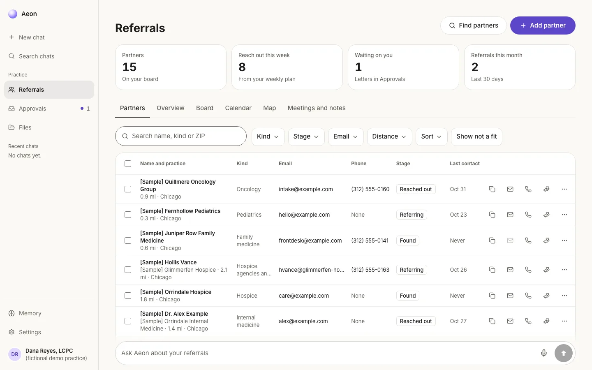

<sub>Every name on screen is fictional [Sample] data for the demo practice, Dana Reyes, LCPC (fictional demo practice).</sub>

</div>

## Why

A new private practice fills its caseload through referral relationships: the oncologist down the street, the hospice social worker, the pediatrician, the pastor. Building those means finding the right people, writing to them, calling, meeting for coffee, remembering what they said and following up. A solo therapist has no one to do that work, so it rarely happens.

Aeon does it with her, on her own computer. It finds the partners, ranks them for her niche with the reasons shown, writes the letters and call scripts, keeps the board and the calendar, and turns a spoken coffee debrief into notes and a follow-up. She approves every outgoing word and sends it herself.

It is practice operations software, not clinical care. It never gives medical or mental health advice.

<div align="center">
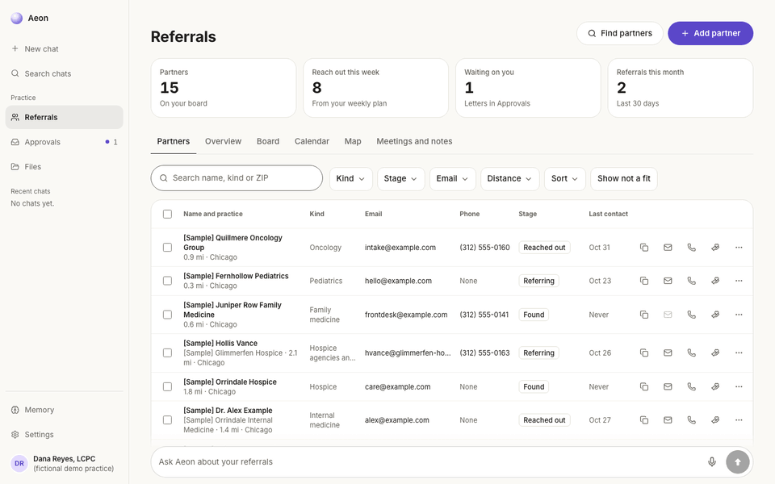
</div>

## What it does

The hackathon demo runs one helper end to end: **Referrals**, a small CRM for the professionals who send a therapist clients.

| | |
|---|---|
| **Partners** | One table with stage, email, phone and last contact; tiles for partners, who to reach out to this week, letters waiting and referrals this month. Partners come from public sources (the free NPPES NPI Registry, Medicare's Provider Data Catalog, OpenStreetMap), each with a "Confirmed by" source and the reasons for its tier. |
| **Find email** | Reads the practice's own website for a public address (respects robots.txt, skips directories and social sites, only an address on the practice's own domain, never a guess). Refused for sensitive organizations and anyone on her do-not-contact list. |
| **Call scripts** | Front desk, provider and voicemail scripts built from her practice facts, with Log this call and Draft follow-up email. |
| **Letters** | Intro and follow-up letters drafted for her niche, waiting in Approvals. She approves, copies and sends from her own email; Aeon never sends. |
| **Board** | Found, Reached out, Met, Referring and Not a fit, with the next step on each card. |
| **Calendar** | Day, week and month views to plan coffees, calls and talks with partners. |
| **Overview** | Where referrals come from (dates and counts only, never who), this week's follow-ups and the partners on a map. |
| **Coffee debrief** | She talks for up to three minutes after a meeting. The audio is transcribed in memory, anything about a patient is dropped before the model hears it, and she reviews the partner profile, a suggested new contact and a follow-up email before anything is saved. |
| **Ask Aeon** | A chat on every page ("Who should I reach out to this week?", "Draft a letter to my top 3"). The same tools are exposed through an MCP server (`npm run mcp`), so any agent can use them. |

## Screenshots

| | |
|---|---|
| 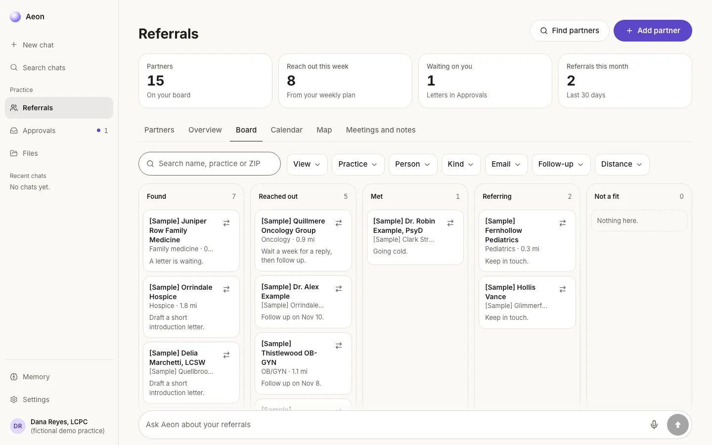 Board | 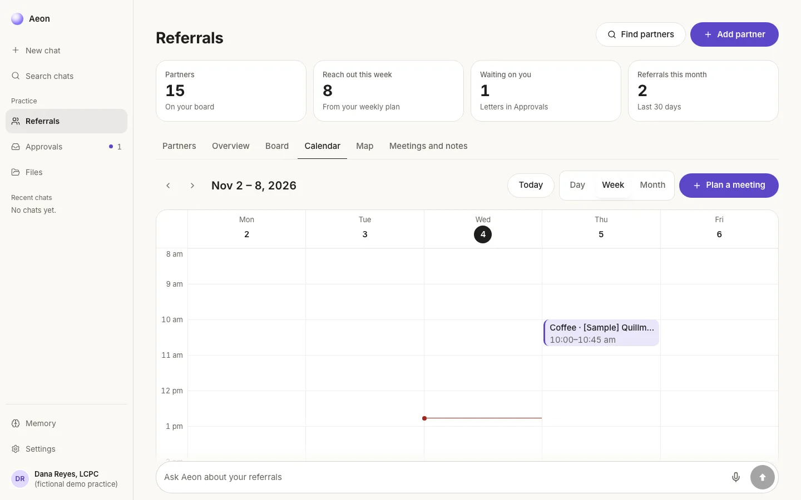 Calendar week |
| 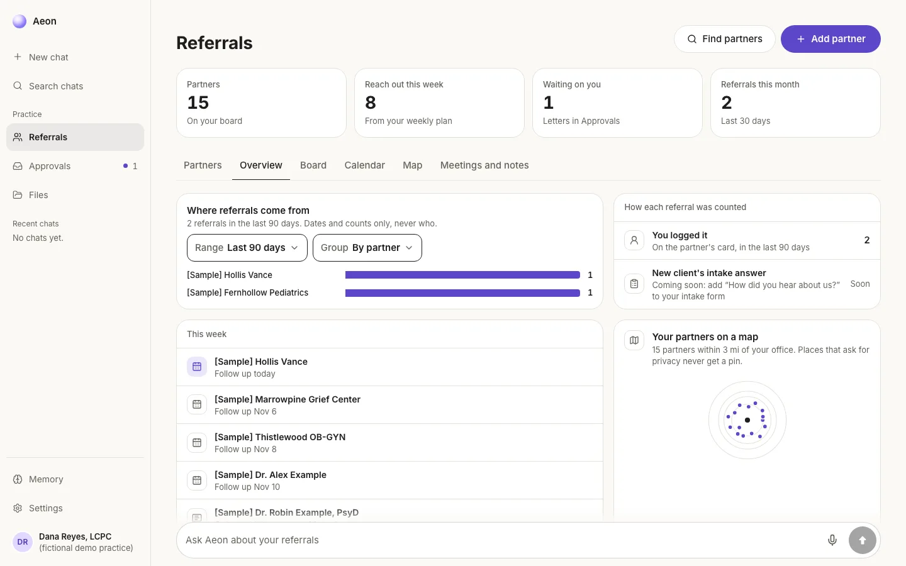 Overview: where referrals come from | 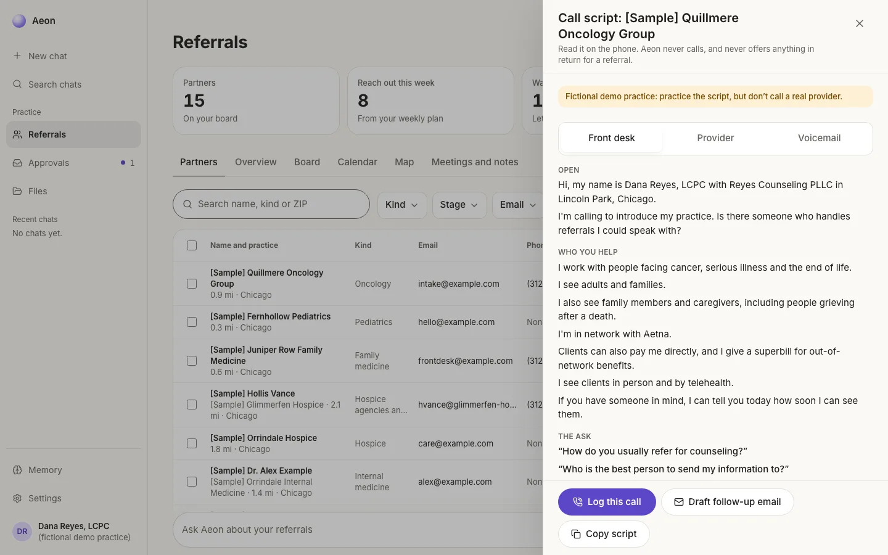 Call script |
| 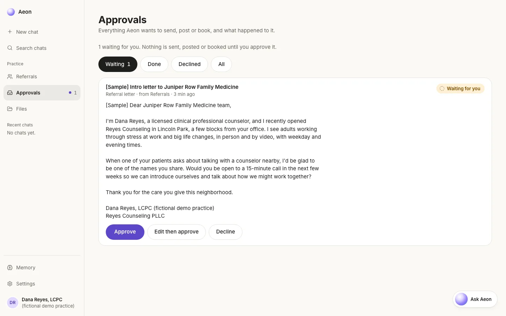 A drafted letter waiting for her OK | 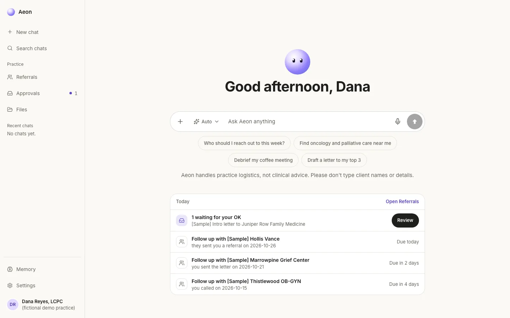 Ask Aeon |
| 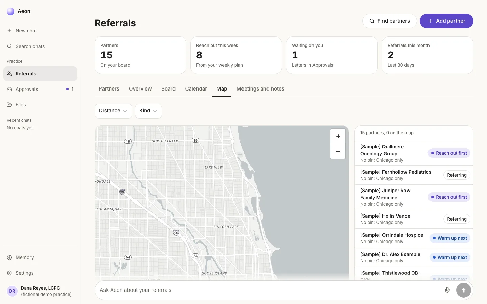 Map (the [Sample] partners have no street address, so they list as "Chicago only") | 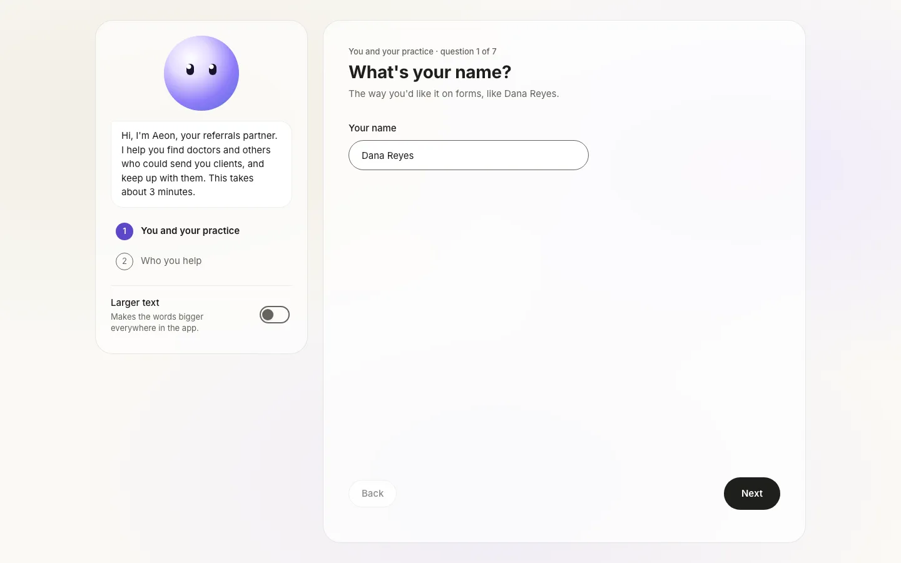 Onboarding |

Dark mode versions of each are in [docs/screenshots/readme](docs/screenshots/readme).

## Safety by design

These are plain code, not prompts, and they run whether or not the model behaves.

- **Approval gate.** Agents and tools only add rows to `approvals`. Nothing is sent, posted or booked until she approves it, and executors (`lib/executors/`) are the only code that acts. Every decision is written to `audit_log`.
- **Crisis check before every model call.** `lib/safety.ts` runs on every message and every debrief transcript. Any mention of self-harm, suicide or danger gets a fixed reply (call or text 988; 911 for emergencies) and an urgent alert, before the model sees anything.
- **Local privacy guard.** `lib/aeon/guard.ts` checks her messages, each tool result, each memory and Aeon's reply: plain-code rules plus a small name-finding model (`lib/aeon/phi-classifier.ts`, bert-base-NER) that runs on her machine. Text is never sent anywhere to be checked, and if the model can't load the text is refused. Until there is a BAA, no client names or details reach the model.
- **No fees or gifts for referrals.** Letters, scripts and debrief notes are checked in plain code (`lib/referrals/value-check.ts`) so nothing of value is ever tied to a referral.
- **`DRY_RUN=true`** makes executors log instead of act.

This is not a claim of HIPAA compliance. It is a design that keeps client details away from the model and keeps her records on her own computer.

## How it uses Meta's models

All calls go through `lib/meta.ts` (base URL `https://api.meta.ai/v1`, her own key), and each one writes a row to `practice_os.model_calls`.

| Model | What it does here |
|---|---|
| `muse-spark-1.3` | Aeon's chat and tool calls (`lib/aeon/agent.ts`), drafting outreach letters (`lib/referrals/outreach.ts`), filling the partner profile from a cleaned debrief through one tool call (`lib/referrals/debrief.ts`) and the memory reflection pass (`lib/aeon/reflect.ts`). The partner ranking and the call scripts are plain code. |
| `muse-voice-transcribe-1.0` | Transcribes the coffee debrief (`lib/referrals/debrief.ts`) and the dictation mic in the message box. |
| `muse-image-1.0` | Images for the Media helper (`lib/growth/image.ts`, `lib/instagram/graphic.ts`), which is switched off in this demo. |

## Architecture

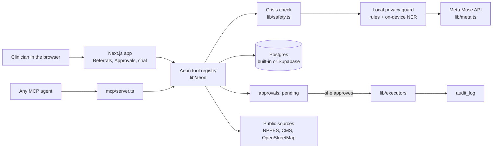

One npm package: a Next.js App Router app, shared code in `lib/`, and an MCP server that imports the same tools. Without `DATABASE_URL` it runs its own built-in Postgres in `.data/`, listening only on 127.0.0.1.

## Quick start

Practice-OS is free and each practice hosts its own copy. There is no central service.

Tell any AI coding agent: "install Practice-OS from this repo". It follows [INSTALL.md](INSTALL.md), asks for each account in plain words, and opens the app at http://localhost:3000. Step-by-step guides for each service are in [docs/self-hosting](docs/self-hosting/README.md).

By hand, with Node 20 or newer:

```bash
npm install
cp .env.example .env
npm run dev
```

`npm run doctor` says what is set up and what is next. Fictional demo data: `npm run db:reset`. MCP server: `npm run mcp`. Tests: `npm test`.

### The demo

The walk-through for the video is in [docs/demo-script.md](docs/demo-script.md). The demo practice is fictional: Dana Reyes, LCPC, Reyes Counseling PLLC, Lincoln Park, Chicago. All sample data is labeled [Sample], and letters for the demo go only to the developer's own test inbox, never to real providers.

## Roadmap

Referrals is the first helper. **Admin** (license and CE calendar, credentialing, Good Faith Estimates, superbills, client forms) and **Media** (Psychology Today profile, a one-page website, practice-logistics posts) are built and switched off for this demo by `REFERRALS_ONLY_DEMO` in [lib/features.ts](lib/features.ts). Set it to `false` to get the full app.

- Admin's compliance rules each carry a jurisdiction, an official source URL, a quote and a last-checked date. Federal and Illinois rules ship verified; other states are researched by Aeon and marked "Aeon researched, please confirm" until she confirms them.
- Front Desk (practice phone line, voicemail, consult booking) is paused behind `FRONT_DESK_ENABLED`.
- Next: Aeon plugs into the business tools she already uses (bookkeeping, payroll, storage) through MCP.

## Built for the Meta Global AI Developer Hackathon

Everything in this repository was built from scratch during the Meta Global AI Developer Hackathon (Indie track, theme: Build for Your World), October 26 to November 4, 2026. The day-by-day record is in [docs/BUILD_LOG.md](docs/BUILD_LOG.md).

Practice-OS is built by **Caseload** (a sole proprietorship).

## Text messages

The Front Desk helper is paused and hidden in the app for now. When on, it texts people who call a practice line and leave a voicemail, to offer times for a free consultation. Scheduling only, never marketing. Reply STOP to opt out, HELP for help. Message and data rates may apply. During the demo, the practice (Reyes Counseling) is fictional and texts go only to the developer's own phone.

- [Privacy Policy](docs/privacy-policy.md)
- [Terms & Conditions](docs/terms.md)
- [How SMS opt-in works](docs/sms-opt-in.md)

## License

Copyright (C) 2026 Isaiah Tennell.

Practice-OS is free software, licensed under the [GNU Affero General Public License v3.0](LICENSE) (AGPL-3.0). You can use, change and share it. If you run a changed version for others over a network, you must share your changes under the same license.
