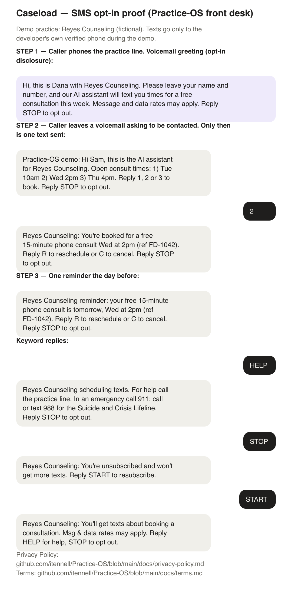

# How SMS opt-in works

Brand: **Caseload** (a sole proprietorship), developer of Practice-OS. Demo practice: Reyes Counseling (fictional). During the demo phase, texts go only to the developer's own verified phone.

## Proof image

The voicemail greeting and every message, as one picture:

## How people opt in

A person opts in by calling the practice phone line and leaving a voicemail asking to be contacted. Nobody is texted from a list, and numbers are never bought or shared.

The voicemail greeting callers hear:

> Hi, this is Dana with Reyes Counseling. Please leave your name and number, and our AI assistant will text you times for a free consultation this week. Message and data rates may apply. Reply STOP to opt out.

Only callers who leave a voicemail get a text, and they get it once.

## The messages, in order

**1. After the voicemail (first message):**

> Practice-OS demo: Hi Sam, this is the AI assistant for Reyes Counseling. Open consult times: 1) Tue 10am 2) Wed 2pm 3) Thu 4pm. Reply 1, 2 or 3 to book. Reply STOP to opt out.

**2. The caller replies:** `2`

**3. Confirmation:**

> Reyes Counseling: You're booked for a free 15-minute phone consult Wed at 2pm (ref FD-1042). Reply R to reschedule or C to cancel. Reply STOP to opt out.

**4. Reminder, the day before:**

> Reyes Counseling reminder: your free 15-minute phone consult is tomorrow, Wed at 2pm (ref FD-1042). Reply R to reschedule or C to cancel. Reply STOP to opt out.

## Keywords

| Caller texts | Reply |
|---|---|
| START, YES | Reyes Counseling: You'll get texts about booking a consultation. Msg & data rates may apply. Reply HELP for help, STOP to opt out. |
| STOP, CANCEL, END, QUIT, UNSUBSCRIBE | Reyes Counseling: You're unsubscribed and won't get more texts. Reply START to resubscribe. |
| HELP, INFO | Reyes Counseling scheduling texts. For help call the practice line. In an emergency call 911; call or text 988 for the Suicide and Crisis Lifeline. Reply STOP to opt out. |

See the [Privacy Policy](privacy-policy.md) and [Terms & Conditions](terms.md).
